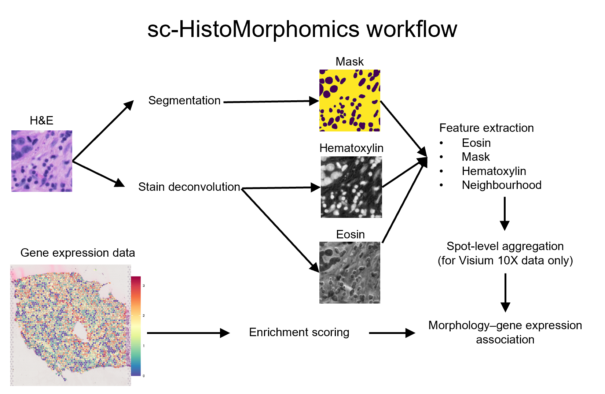

# Sc-HistoMorphomics
Sc‑HistoMorphomics is a scalable framework for profiling nuclear morphology in whole‑slide H&amp;E images and correlating these measurements with spatial transcriptomics data.




``
## Installation
```bash
# To install the environment required for this tool:

Create and activate environment
conda create -n Sc-HistoMorphomics python=3.8 -y
conda activate Sc-HistoMorphomics

## Upgrade pip
pip install --upgrade pip

## Install TensorFlow
pip install tensorflow

## Install stardist
pip install stardist

## Install wxPython (needed for CellProfiler GUI)
wget https://extras.wxpython.org/wxPython4/extras/linux/gtk3/ubuntu-20.04/wxPython-4.1.0-cp38-cp38-linux_x86_64.whl
pip install wxPython-4.1.0-cp38-cp38-linux_x86_64.whl

## Install CellProfiler (specific version)
pip install git+https://github.com/CellProfiler/CellProfiler.git@v4.2.5

## Install additional dependencies
conda install dask -y
pip install opencv-python
conda install -c conda-forge python-javabridge -y
pip install zarr
pip install geojson
pip install imagecodecs
